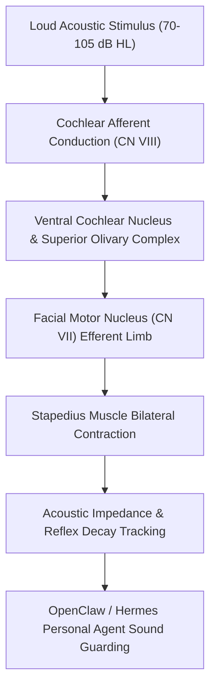

# Acoustic Stapedial Reflex Threshold (ART) Skill

[](LICENSE)
[](https://www.python.org/)
[](requirements.txt)
[](mcp_server.py)
[](SKILL.md)

Zero-dependency sovereign personal agent skill for evaluating Acoustic Stapedial Reflex Thresholds (ART), sensation level (SL), 10-second reflex decay rate, and middle ear protective resilience.



## Features
- **Deterministic Math**: Pure Python standard library implementation with zero external dependencies.
- **Audiology & Otology Standards**: Formulates ipsilateral/contralateral ART thresholds, Metz loudness recruitment, and acoustic reflex decay.
- **Acoustic Fatigue & Retrocochlear Guard**: Sensitive screening for auditory nerve conduction fatigue and middle ear biomechanical stiffness.
- **Model Context Protocol (MCP)**: Native JSON-RPC tool integration for LLMs and autonomous agents.

## Quickstart

```python
from client import AcousticStapedialReflexClient

client = AcousticStapedialReflexClient()
result = client.evaluate_stapedial_reflex(
    ipsilateral_threshold_db_hl=80.0,
    contralateral_threshold_db_hl=85.0,
    stimulus_freq_hz=1000,
    reflex_decay_10s_pct=12.0
)
print("Sensation Level:", result["sensation_level_db_sl"], "dB SL")
print("Middle Ear Score:", result["middle_ear_score"])
print("Classification:", result["classification"])
```

## License
Apache-2.0
